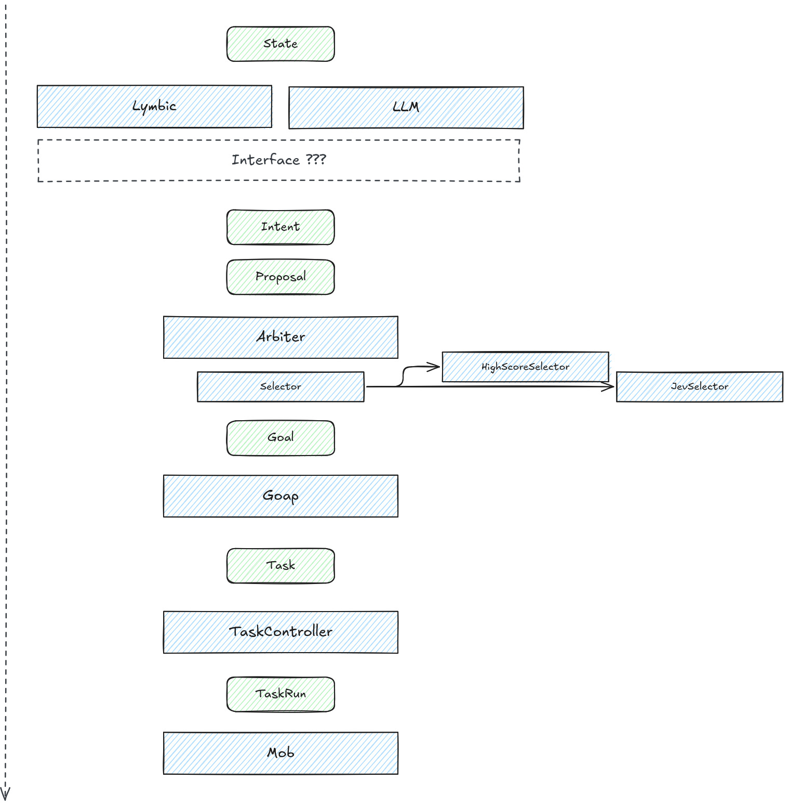

## How Mobs are programmed

## My implementation

## The State

## Intents And Proposals

### Lymbic

### LLM

## Arbiter

### Selectors

## Goap

## Task System

### Lifecycle

## The Mob doing stuff

## Links
Resources that I used for this.

- [Test]()
- [Test]()
- [Test]()
- [Test]()
